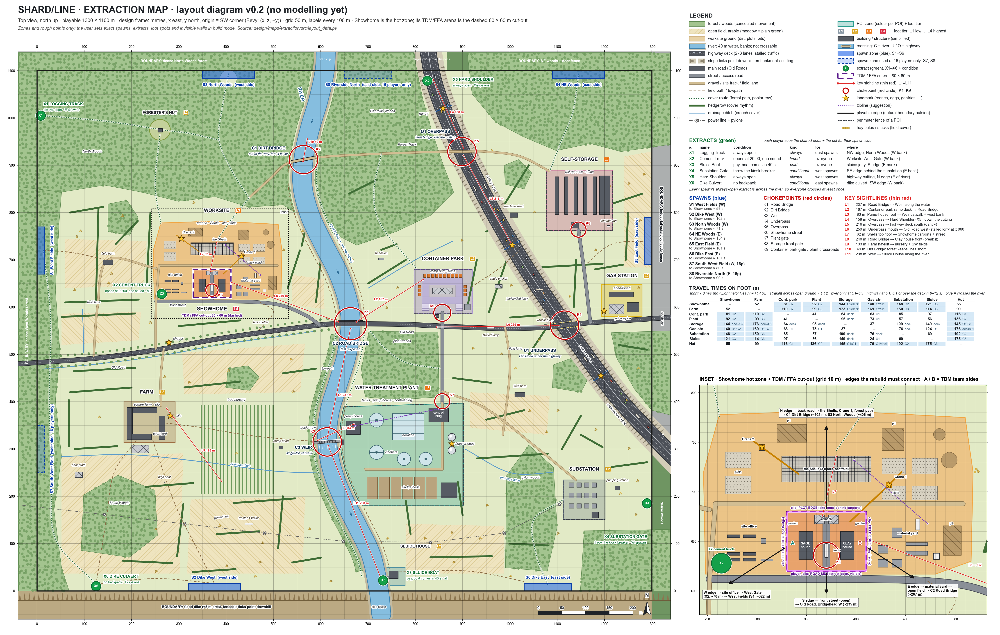

# Extraction map: layout (diagram v0.2, for review before any modelling)



This is the top-view layout of the medium extraction map that has **Showhome as its hot zone**. It covers the
diagram and the document only. Nothing is modelled yet. It follows
`art/briefs/showhome_rebuild/01_EXTRACTION_MAP_DIAGRAM.md`, the user's decisions in `art/DIRECTION_LOG.md` (items
16–18) and the material and collision contract in `art/briefs/MAP_MATERIALS_SPEC.md`.

**This is zones and rough points only.** The user sets the exact spawn points, extracts, loot spots and invisible
walls later in the in-game build mode (`02_BUILD_MODE.md`). The numbers below are the starting values for that.

| File | What it is |
|---|---|
| `diagram.svg`, `diagram.png` | The diagram (the same matplotlib figure saved twice; the SVG keeps its text editable). |
| `src/layout_data.py` | **The single source of truth:** every zone, line, point and condition. Change the layout here. |
| `src/make_diagram.py` | Draws both files, computes crossings, travel times and the cover check, writes the JSON and refreshes the `AUTO` tables in this file. |
| `src/geom.py` | Small geometry helpers (splines, offsets, intersections). numpy only. |
| `data/extraction_layout.json` | Machine-readable layout for later agents (build mode, Blender blockout). |

Regenerate everything after an edit to `layout_data.py`:

```bash
cd "F:/git/val etf/design/maps/extraction/src"
PYTHONIOENCODING=utf-8 python make_diagram.py
```

## What changed in v0.2 (2026-10-09)

The user approved v0.1 and asked for a bigger map.

- **Size: 1000 × 900 m became 1300 × 1100 m (1.43 km², +59 %).** At the default sprint of 7.0 m/s:
  - a full east–west crossing takes about **3.1 min**;
  - north to south takes **2.6 min**;
  - corner to corner takes **4 min**.
- **The map was not stretched uniformly.**
  - Every POI kept its own footprint and inner layout, and only moved.
  - The land between the POIs was scaled up: the river's course, the highway's course, the roads, the fields and
    the woods. The extra space became open fields, hedgerows and woods between the POIs, and wider approaches.
  - The river (40 m), the highway (deck 34 m, slopes 12 m), the road widths and the crossings are unchanged.
  - The plant and the sluice house moved so that they keep their exact relation to the river and the weir.
  - `GROUP_OFFSET` and `MAP_SCALE` in `layout_data.py` record how every v0.1 coordinate maps to v0.2.
- **Showhome and the inset keep the same shape.** The TDM cut-out is still 80 × 60 m. It moved from
  x 250–330, y 500–560 to **x 330–410, y 620–680**, a rigid move of (+80, +120).
  - The worksite moved with it, so it still hugs the back of Showhome: the show homes sit in front of the
    construction site, as in the user's composition.
- **Cover rhythm.** A new cover check measures, for every bit of open ground, the distance to the nearest thing
  to duck behind (the table is in section 3). Guided by it, v0.2 adds:
  - 39 more hedgerows, 2 more ditches and 41 more hay stacks;
  - 5 small woods: the West, Farm, East and NE copses, and the East Woods in the pocket behind U1;
  - 14 small field structures (L1): two field barns, a high seat, a tractor and trailer, a pump shed, a bus shelter,
    a cattle shelter, a camper van, beehives, a sheepfold, a stalled lorry, a wrecked car, a machine shed and a
    pumping station;
  - two field lanes (the West Fields and the pylon field).
- **Spawns:** two extra zones, **S7** (west side) and **S8** (east side), which open only in a 16-player raid
  (section 6).
- **Names:** all callouts are in English. Extract X1 is renamed **Logging Track**, so that it no longer shares a
  name with the Forest Track road.

## 1. Size, frame and boundary

- **Playable rect: 1300 × 1100 m (1.43 km²)**, x 0..1300 (east), y 0..1100 (north).
- **Frame:** the project's design frame (metres, x east, y north, z up, origin at the south-west corner), the same
  as Showhome and the range. Bevy = `(x, z, −y)`, so map north is Bevy −Z.
- **Terrain:** flat Flemish edge-of-town land, ±1 m everywhere except:
  - the highway (a −6 m cutting north of y ≈ 794, a +6 m embankment south of y ≈ 752);
  - the river (water 2.5 m below the bank tops);
  - the dike (+5 m);
  - the worksite pits (−2 m) and soil heaps (+3 m).
- **Hard boundary.** Every edge reads as natural, with `player_clip` behind the visible barrier up to the hard
  ceiling:

| Edge | What the player sees |
|---|---|
| West | The dense West Woods: a tight pine plantation behind a forest strip. X1 leaves along a logging track. |
| North, west of the river | The dense North Woods, rising slightly. The river enters under a clip at the edge (x ≈ 608). |
| North, east of the river | The Riverside Woods, then the highway cutting (x ≈ 834; clipped across the deck just past X5), then the NE woods with a deer fence. |
| East | An industrial-estate palisade fence with closed warehouses behind it. The Old Road ends at a police roadblock of concrete blocks (y ≈ 576). The highway leaves at y ≈ 330 (clipped across the deck). South of it: dense woods. |
| South | A **flood dike** along the whole width: +5 m with a fenced crest, slopes facing the map. The river leaves through the dike sluice (x ≈ 723). X6 is a culvert through it. |

## 2. The two halves

The river splits the map. The two halves have different characters.

- **West bank: "the new district".** Soft, open and green:
  - the Showhome worksite (the hot zone);
  - the square farm;
  - big fields with hedgerows, ditches, copses and a tree nursery;
  - the large North Woods.

  Sightlines are long across the fields and short in the woods. The highest loot (L4) is here.
- **East bank: "the industrial edge".** Hard, fenced and vertical:
  - the water treatment plant;
  - the container park;
  - the substation;
  - the pylon field;
  - the highway on its cutting and embankment;
  - beyond the highway, the self-storage, the abandoned gas station and the East Woods.

  There is concrete cover, there are fences and gates, and there are perches. There are more L3 sites here, and
  they are closer together.

The highway is a second barrier inside the east half. It cuts off the north-east pocket (Storage and Gas), which
can only be reached through **U1**, through **O1**, or by scrambling over the deck.

## 3. Points of interest

<!-- AUTO:pois -->
| POI | Loot | Footprint (design m) | Area | Travel-time node |
|---|---|---|---|---|
| Showhome | L4 | x 330..410, y 620..680 (80 × 60) | 0.48 ha | (370, 648) |
| Worksite | L3 | polygon, bbox x 246..518, y 617..782 | 4.29 ha | (380, 720) |
| Farm | L2 | x 184..292, y 314..400 (108 × 86) | 0.93 ha | (230, 355) |
| Forester's Hut | L2 | clearing r 22 at (260, 975) | 0.15 ha | (260, 975) |
| Container Park | L2 | x 797..920, y 586..680 (123 × 94) | 1.16 ha | (857, 632) |
| Water Treatment Plant | L3 | polygon, bbox x 640..902, y 181..397 | 5.29 ha | (847, 373) |
| Substation | L2 | x 1113..1201, y 151..235 (88 × 84) | 0.74 ha | (1157, 193) |
| Self-Storage | L3 | x 1077..1217, y 762..890 (140 × 128) | 1.79 ha | (1145, 826) |
| Gas Station | L2 | x 1193..1279, y 580..648 (86 × 68) | 0.58 ha | (1235, 611) |
| Sluice House | L2 | x 736..778, y 12..50 (42 × 38) | 0.16 ha | (756, 32) |
<!-- /AUTO:pois -->

Loot tiers run from **L1** (low) to **L4** (highest), and the user places the actual loot spots in build mode.
Heights are in metres above the local ground. Every POI keeps its v0.1 size and inner layout.

### Showhome (hot zone core) — L4

- **Size:** the TDM rect, **x 330..410, y 620..680** (80 × 60 m). Section 7 has the cut-out.
- **What it is:**
  - two finished show homes, Sage (west) and Clay (east), on either side of a short central street with the
    moving truck;
  - back gardens on the outer sides, each with a greenhouse, a shed, a carport, planters and a hot tub;
  - the open front street to the south.
- **Height levels:**
  - ground floor 0;
  - upper floor and the roof terrace over the garage 3.2;
  - the truck box 3.2, which is a perch;
  - the gables cannot be stood on.
- **Loot (L4):** furnished show-home interiors staged for viewing. Kitchen cabinets, dressers, wardrobes, a desk and
  the moving boxes in the truck. They are lootable containers in the "slightly open" style
  (`03_LOOT_CONTAINERS.md`).
- **Cover:**
  - outer walls stop bullets, and interior drywall can be wallbanged;
  - hedges can be shot through at their corners, and picket fences are see-through;
  - the truck is the centre cover.
- **Why fight here:**
  - close-quarters house clearing with wallbangs;
  - the street duel around the truck;
  - pressure from two outside angles: the Shells overlook the back of the plot (L7, 62 m), and the Road Bridge
    sees the Clay front (L8, now 240 m: a sniper line the rebuild must still break).

### Worksite (the rest of the hot zone) — L3

- **Size:** a 4.3 ha polygon around Showhome (bbox x 246..518, y 617..782), with mesh site fencing (open panels)
  and gaps.
- **What it is:**
  - **Crane 1** (NE of Showhome at about (433, 707), its jib over the street) and **Crane 2** (NW, about
    (305, 745)): the map's main landmarks.
  - **The Shells:** a row of four half-built terraced houses (x 325..415, y 710..736).
    - Bare concrete slabs at 0, 3 and 6 m, with the roof slab at 9 m.
    - Scaffolding with ladders. The upper floors have no walls yet.
  - **The site office compound** at the West Gate: office containers stacked two high (roofs at 2.6 and 5.2),
    porta-potties, toolbox containers and a generator. The site manager's office holds the L3 loot (a lockbox).
  - **The material yard** east of Showhome: pallet stacks, rebar racks, pipe stacks, a tipper truck and the
    excavator.
  - **Plots and pits:** foundation slabs with rebar, three excavation pits 2 m deep with ramps, and soil heaps
    3 m high.
  - **The cement mixer truck** at the West Gate. It is extract X2.
- **Composition (the user's pick):** the show homes sit **in front of** the construction site. They line the front
  street, and the worksite starts directly behind their back gardens, with no gap
  (`art/briefs/showhome_v3_handoff/concept_worksite/COMPOSITION_showhome_in_front_of_site.png`).
  - Showhome and the worksite moved together as one rigid group, so in v0.2 the back road still runs 8 m behind
    the cut-out's north fence and the Shells start 30 m behind it.
  - The site office compound and the material yard flank the plot towards the back.
- **What surrounds it in v0.2:** wider fields on every side, which makes it the "open fields around the hot zone"
  of the user's idea.
  - **West:** about 250 m of West Fields to the edge, with a field barn and a copse.
  - **North:** about 30–60 m of meadow to the North Woods.
  - **East:** about 230 m of open ground to the river.
  - **South:** about 70 m of verge field to the Old Road.
- **Why fight here:**
  - lots of waist-to-head cover;
  - vertical play from the Shells and the container roofs;
  - the pits as hidden flanks;
  - four ways in: the front street, the West Gate, the back road and the forest path from the north.
- **Zipline Z1** (a suggestion): from the Shells' roof down to the material yard.

### Highway (E-road with an overpass and an underpass) — L1–L2

- **Size:** a corridor 58 m wide (34 m deck plus 12 m slopes on each side), running about 900 m from the north edge
  (x ≈ 834) to the east edge (y ≈ 330). It curves gently, so the deck never gives one straight line end to end.
- **Height levels:**
  - in a **cutting** (−6 m) north of y ≈ 794 and on an **embankment** (+6 m) south of y ≈ 752;
  - slopes of about 27°, which are walkable;
  - a 2 m mesh fence at the foot or top of each slope, which a player can mantle.
- **Deck:**
  - 2 × 3 lanes, a median barrier and hard shoulders;
  - stalled traffic about every 30 m (car boots and gloveboxes are L1–L2 containers);
  - a **jackknifed lorry** at y ≈ 635;
  - **three sign gantries** (at y 1020, 731 and 455), which are landmarks.
- **Crossings:**
  - **U1 Underpass** at (1116, 562): the Old Road passes under the embankment through a box tunnel of about 40 m.
  - **O1 Overpass** at (899, 929): a farm bridge over the cutting.
  - **Over the deck anywhere:** about 8–12 s slower, and exposed along the deck.
- **Why fight here:**
  - the deck is a long, broken lane (L4 158 m, L5 216 m);
  - O1 looks straight down on X5;
  - the embankment top overlooks the container park and the embankment field.

### Water treatment plant — L3

- **Size:** 5.3 ha (bbox x 640..902, y 181..397), fenced with a 2.4 m palisade. The west fence follows the east
  bank. The gate (K7) is on the north side at x 857, at the end of the plant road through the plant woods.
- **What it is:**
  - **The inlet pump house** at the weir: 2 floors plus a basement at −3, with a roof at about 7 m that overlooks
    the weir (L3, 83 m).
  - **Two primary clarifiers** (Ø 30 m) and **two secondary clarifiers** (Ø 28 m). Their rims are 1.5 m high and
    give curved cover, and each has a rotating bridge you can walk across.
  - **The aeration basin block:** 66 × 56 m, four lanes with catwalks at +1.5 between them. The water sits at −3;
    a player who falls in climbs out at ladders.
  - **The two digester eggs** (about 20 m tall): the plant's landmark.
  - **Six sludge drying beds** with 0.8 m walls, which are crouch cover, plus a sludge press shed.
  - **The control building:** 3 floors (0, 3.5, 7) and a roof at 10.5 with a stair tower. It is the plant's
    stronghold and holds the best loot: the control room, offices, a lab and lockers (L3, with a possible L4
    server room).
- **Why fight here:**
  - round tanks make curved cover and odd angles;
  - long internal lanes;
  - the control building as a fortress;
  - the pump house holds the weir crossing.
- **Zipline Z2** (a suggestion): from the control building's roof down to the pump house's roof. It is fast but
  exposed.

### Container park (recycling park) — L2, with an L3 e-waste shed

- **Size:** 123 × 94 m (x 797..920, y 586..680). It is fenced.
  - The gate and guard hut (K9) sit on the Old Road, at a crossroads with the plant road (x 857).
- **What it is:**
  - **An elevated ramp ring:** the deck is 15 m wide at +2.5, built around a courtyard, with an up-ramp at the SW
    and a down-ramp at the SE.
  - **16 skips** (6 × 2.5 m, open tops) along the outside of the ring. Their rims are level with the deck edge, so a
    player on the deck looks down into them.
  - **A roofed e-waste shed** in the courtyard: PCs, TVs and cables, which makes it the electronics pocket (L3).
  - **A hazardous-waste cage** by the gate.
- **Why fight here:**
  - height (the deck) against cover (the skips);
  - the courtyard is a pit that the ring overlooks;
  - the deck sees the Road Bridge (L2, 167 m: now a scoped-gun angle rather than an AR one).

### Self-storage — L3 (locked units L4)

- **Size:** 140 × 128 m (x 1077..1217, y 762..890), with a 2.4 m palisade fence.
  - The front gate (K8, south) has the office and leads down the storage road to the Old Road and the gas station.
  - The rear gate (north-west) leads to the Forest Track and O1.
- **What it is:**
  - **Five single-storey rows of roll-up units**, each 8 × 80 m.
    - The flat roofs are at 3 m. A player reaches them with a jetpack hop or the ladders at the row ends.
    - The aisles between the rows are 12 m wide and give N–S lines of 80 m.
  - **A two-storey indoor block:** climate-controlled units along corridors, with an internal stair. This is
    close-quarters ground.
  - **The office**, with the key cabinet.
- **Loot:** units with the roll-up door ajar are lootable (L3). Locked units are L4 and need a key (see question 7).
- **Why fight here:** a grid of lanes, the rooftops as overwatch over the aisles, and the indoor block for
  close-quarters fights.

### Abandoned gas station — L2

- **Size:** 86 × 68 m (x 1193..1279, y 580..648), on the Old Road east of U1. It was left to die when the motorway
  opened.
- **What it is:**
  - **A canopy** of 32 × 20 m with its roof at 5 m: a jetpack perch over the forecourt.
  - **Three pump islands**, which are hard cover.
  - **The shop**, 26 × 20 m: the tills, a stockroom and a back office (L2, with a small L3 chance).
  - **The car-wash tunnel**, 52 × 10 m with open ends: a shooting tube.
  - **The tall price pylon** (12 m, with faded blank panels): the landmark.
- **Why fight here:**
  - it is compact;
  - the canopy perch fights the shop;
  - it covers the U1 exit, about 80 m away, so it ambushes players coming through the underpass. The East Woods
    across the road give the counter-approach.

### Forest strips — L1 (hidden stashes)

- **Cover:**
  - tree trunks are `wood_thick` and stop bullets;
  - canopies are `FOL_canopy` volumes;
  - the undergrowth is `foliage_thin`, which bullets pass through.
- **Sightlines** are 30–50 m inside the woods.
- **Their job** is to connect spawns, POIs and crossings under cover (the dotted green cover routes on the
  diagram).
- **The copses** (new in v0.2) are small field woods that break up the long fields.

<!-- AUTO:landcover -->
| Land cover (forest unless noted) | Area in the map | Role |
|---|---|---|
| North Woods | 14.6 ha | NW woods: S3 and X1, cover from the worksite's north to the Dirt Bridge |
| Riverside Woods | 8.0 ha | east-bank woods: Dirt Bridge to the Overpass and the container park |
| West Woods (boundary) | 3.8 ha | west boundary strip: S1 to X6 along the edge |
| South Woods | 2.2 ha | SW patch: cover between the farm and X6 |
| Poplar row | 0.8 ha | poplar row on the west bank: Road Bridge to the Weir and the sluice, under cover |
| Plant woods | 2.2 ha | screen between the Road Bridge and the plant fence |
| Pylon woods | 2.4 ha | S6 to the substation |
| SE woods | 1.9 ha | SE corner behind the substation |
| NE woods | 5.5 ha | S4 to the storage rear gate |
| West copse | 0.4 ha | field copse in the West Fields |
| Farm copse | 0.3 ha | field copse between the farm and the Old Road |
| East copse | 0.4 ha | field copse in the pylon field, east of the plant |
| East Woods | 0.9 ha | pocket east of the highway: cover to U1's east mouth and the gas station |
| NE copse | 0.3 ha | field copse between the highway cutting and the storage |
| Arable fields (striped) | 20.7 ha | open ground with hedgerows, ditches, hay |
| **All forest** | **43.7 ha** (31 % of the map) | |
<!-- /AUTO:landcover -->

### Open fields — L1

- **Where:**
  - the West Fields (pasture and arable) between S1 and the worksite;
  - the SW fields around the farm and the nursery;
  - the verge field between the Old Road and Showhome;
  - the east-bank meadow north of the container park;
  - the embankment field between the container park and the highway;
  - the pylon field east of the plant;
  - the NE field by S5;
  - the SE strip south of the plant.
- **Cover rhythm.** The brief asks for it because lines over 150 m are deadly. It comes from:
  - **hedgerows** (houtkanten) every 60–80 m;
  - **hay bale stacks**;
  - **drainage ditches** about 1 m deep (crouch cover);
  - **copses**;
  - the **tree nursery** (a row of young trees every 8 m);
  - the **avenue trees** along the west Old Road (one every 15 m);
  - the **power-line pylons** (`metal_heavy`);
  - the **small field structures** (barns, shelters, vehicles).
- **The rule:** no open run longer than about 40 m without something to duck behind. No unbroken standing-height
  line over 150 m across a field, except the deliberate sniper lanes listed in section 5.

**The cover check.** The open ground is everything that is not woods, a POI, the nursery, the river or the highway
corridor. For each point of open ground, the check measures the distance to the nearest cover:
- hedgerows, ditches, hay, avenue trees, structures and pylons;
- the edges of woods and POIs;
- the dike foot and the highway slopes.

<!-- AUTO:cover -->
| Open ground | Within 20 m of cover | Within 30 m | Within 40 m | Farthest point from cover |
|---|---|---|---|---|
| 71 ha (49 % of the map) | 73 % | 94 % | 99.7 % | 45 m at (692, 596) |
<!-- /AUTO:cover -->

### Small POIs

- **Farm** (square farm, *vierkantshoeve*), L2.
  - **Size:** x 184..292, y 314..400.
  - **What it is:**
    - four wings around a courtyard: the farmhouse to the south, stables to the west, the barn with a hayloft at
      +4 to the north, and a machine shed to the east;
    - the **silo** (Ø 9 m, about 18 m tall), a landmark;
    - an open hay barn to the south.
  - **Why fight here:** a courtyard with three ways in. The hayloft overlooks the nursery and the SW fields (L9,
    193 m).
- **Substation**, L2.
  - **Size:** x 1113..1201, y 151..235.
  - **What it is:**
    - a fenced transformer yard: 12 transformers in a grid, which give `metal_heavy` cover;
    - gantries;
    - the control kiosk with the breaker for X4.
  - The power line leaves from here to the west across the south fields. Its pylons are landmarks.
- **Forester's Hut**, L2. A cabin in a North Woods clearing at (260, 975) on the X1 track, with a hunter's high seat
  at the clearing edge.
- **Sluice House**, L2. The lock-keeper's house at the dike sluice on the east bank (x 736..778, y 12..50). The X3
  call post is on its jetty.
- **Chapel**, a micro landmark. A roadside chapel (*kapelleke*) at the farm-lane junction on the Old Road, at about
  (279, 525).

### Landmarks for orientation

Orientation relies on four tall landmarks plus a few low ones:

- **Tall:** the two **cranes** (worksite), the **digester eggs** (plant), the three **highway gantries** and the
  **price pylon** (gas station).
- **Low:** the **farm silo**, the **chapel** and the line of **power pylons**.

## 4. The river and its crossings

- **The river:**
  - **water:** 40 m wide;
  - **banks:** 5 m of riprap or sheet piling, with the water 2.5 m below the bank tops;
  - **towpaths:** one on each bank.
- **It flows north to south** and leaves through the dike sluice. It is about 950 m long inside the map.
- **The width is a gameplay number.** A full jetpack hop covers about 20–28 m (5.65 m of rise at most, 1.6 s of
  fuel, 7–9 m/s of horizontal speed), so 40 m of water plus the banks (about 50 m from bank top to bank top)
  cannot be hopped. Whether players can swim is question 3.

<!-- AUTO:crossings -->
| Id | Crossing | Centre (design m) | Length | Note |
|---|---|---|---|---|
| C1 | Dirt Bridge | (564, 912) | 53 m | farm-track bridge, timber deck on old piers, 4 m wide; forest down to the water on both banks |
| C2 | Road Bridge | (663, 565) | 53 m | concrete girder bridge, 13 m wide (2 lanes + footpaths), 1 m parapets, two wrecked cars; fully exposed |
| C3 | Weir | (614, 315) | 53 m | weir with 7 sluice gates and a 1.4 m railed service catwalk; single file, loud water, no cover |
| U1 | Underpass | (1116, 562) | 70 m | Old Road passes under the embankment: ~40 m box tunnel under the deck, 2 lanes, centre pillars, dark |
| O1 | Overpass | (899, 929) | 69 m | farm-access bridge over the cutting, 5 m wide, 1.1 m parapets; looks straight down the deck |

Straight-line spacing: C1 ↔ C2 361 m, C2 ↔ C3 255 m. River length in the map: 947 m. Highway length in the map: 903 m.
<!-- /AUTO:crossings -->

| Crossing | Risk profile | Sightlines on it |
|---|---|---|
| **C1 Dirt Bridge** (NW) | **Out of the way, with cover.** The woods reach the water on both banks, so the danger is a close ambush rather than a sniper. It is about 300 m from Showhome and leads on to the Riverside Woods, O1, Storage and X5. | Short only (L10, 49 m). |
| **C2 Road Bridge** (centre) | **Fast but exposed.** It is the Old Road, the main artery between Showhome and the east half. It has 1 m parapets to crouch behind and two wrecked cars, but no cover against height. In v0.2 its overwatch angles are all beyond 150 m, so it is a scoped-gun and sniper crossing. Close fights happen at the bridgeheads: the bus shelter and the avenue on the west, the plant woods and the K9 crossroads on the east. | L2 from the container-park deck (167 m), L1 down the river from the Weir (237 m), L8 from the Clay front (240 m), and L6 along the Old Road from U1 (259 m, broken by the stalled lorry). |
| **C3 Weir** (south) | **A different risk: single file and loud.** The railed catwalk is 1.4 m wide over seven sluice gates. The water masks footsteps on and near the weir, for attackers and defenders alike. It leads straight into the plant's west side; the west end opens onto the poplar row and the nursery. | L3 from the pump-house roof (83 m), L1 from the Road Bridge (237 m), and L11 down the river to the sluice (298 m). |

## 5. Routes and flow

- **Main road, the Old Road (E–W).** It runs from the west edge past the chapel and the farm lane to Bridgehead
  West at (598, 562), where the front street joins. Then:
  1. it crosses **C2**;
  2. it reaches the **K9 crossroads** (the container park gate to the north, the plant road to the south);
  3. it passes the stalled lorry (x ≈ 960) and the wrecked car;
  4. it goes through **U1**;
  5. it passes the storage road and the gas station;
  6. it ends at the roadblock on the east edge.

  West of the river it is a tree-lined road.
- **Streets:**
  - the front street (Showhome);
  - the container park access;
  - the plant road;
  - the storage road.
- **Gravel tracks and field lanes:**
  - the worksite's site road, site tracks and back road;
  - the **Forest Track**, from the worksite's north over **C1** and **O1** to the storage rear gate;
  - the farm lane;
  - the West Fields lane;
  - the pylon-field lane;
  - the substation service track;
  - the plant's internal road.
- **Field paths:**
  - the towpaths on both banks;
  - farm to the Weir;
  - farm to the dike;
  - farm to the South Woods and X6;
  - the West Fields path;
  - the verge path;
  - the embankment field;
  - the east field;
  - the dike paths east and west.
- **Cover routes** (dotted green on the diagram) are where a player can move unseen:

| Route | Through |
|---|---|
| S3 → the worksite's north and C1 | North Woods |
| Forester's Hut → X1 | North Woods |
| S1 → S7 → X6 | along the West Woods edge |
| C1 → O1 and the container park | Riverside Woods |
| C2 → the plant | plant woods |
| C2 → C3 → the Sluice House | the poplar row on the west bank |
| S4 → the storage rear gate | NE woods |
| S6 → the substation | pylon woods |

- **The highway as a barrier:** two structures (U1, O1) plus a slow, exposed scramble over the deck. Storage, Gas
  and the East Woods form the "pocket" behind it.
- **Chokepoints:**
  - K1 Road Bridge, K2 Dirt Bridge, K3 Weir, K4 Underpass and K5 Overpass;
  - K6 Showhome street, K7 Plant gate, K8 Storage front gate, and K9 Container-park gate / plant crossroads.
- **The flow this layout aims for:**
  1. **0–1.7 min:** west spawns reach the worksite and Showhome first (59–102 s), while east spawns take Storage,
     Gas, the plant or the substation (23–43 s to the nearest POI).
  2. **2–8 min:** both sides must cross the river to reach their always-open extract, so the three crossings heat up
     in the middle of the raid. East players heading for Showhome arrive as a second wave (about 2.5 min).
  3. **20:00 onward:** the timed Cement Truck (X2) pulls players back to the worksite for a late fight.

### Key sightlines

<!-- AUTO:sightlines -->
| Id | From → to | Length | Read |
|---|---|---|---|
| L1 | Road Bridge ↔ Weir, along the water | 237 m | sniper lane (> 150 m): needs cover breaks |
| L2 | Container-park ramp deck → Road Bridge | 167 m | sniper lane (> 150 m): needs cover breaks |
| L3 | Pump-house roof → Weir catwalk + west bank | 83 m | AR still strong (60–90 m) |
| L4 | Overpass → Hard Shoulder (X5), down the cutting | 158 m | sniper lane (> 150 m): needs cover breaks |
| L5 | Overpass → highway deck south (gantry) | 216 m | sniper lane (> 150 m): needs cover breaks |
| L6 | Underpass mouth → Old Road west (stalled lorry at x 960) | 259 m | sniper lane (> 150 m): needs cover breaks |
| L7 | Shells top floor → Showhome carports + street | 62 m | AR still strong (60–90 m) |
| L8 | Road Bridge → Clay house front (break it) | 240 m | sniper lane (> 150 m): needs cover breaks |
| L9 | Farm hayloft → nursery + SW fields | 193 m | sniper lane (> 150 m): needs cover breaks |
| L10 | Dirt Bridge: forest keeps lines short | 49 m | AR full damage zone (≤ 60 m) |
| L11 | Weir → Sluice House along the river | 298 m | sniper lane (> 150 m): needs cover breaks |
<!-- /AUTO:sightlines -->

For reference, the AR does full damage to about 35 m and is still strong to 60–90 m (`weapons.ron` falloff). The
Warden reaches 500 m.

Because the map is bigger, most long lines grew by about 25 %. The crossings and the highway are now
scoped-gun and sniper ground. The close and medium fights live inside the POIs, at the bridgeheads and in the
cover rhythm of the fields.

### Travel times between POIs

The table gives seconds on foot at the default **sprint of 7.0 m/s** (no or Light halo). For other weights,
multiply: Medium ×1.05, Heavy ×1.14.

- **Route model:** a straight line across open ground × 1.12, for fences, hedges and small detours.
- **River:** crossed only at C1–C3.
- **Highway:** crossed at U1, at O1, or over the deck, which adds 8 s on the embankment and 12 s in the cutting.
- **Brackets** list the crossings each route uses.

The model is rough on purpose: players cut across fields. Ziplines, slides and jetpack hops make real runs a little
faster.

<!-- AUTO:travel -->
| from \ to | Showhome | Farm | Container Park | Water Treatment Plant | Self-Storage | Gas Station | Substation | Sluice House | Forester's Hut |
|---|---|---|---|---|---|---|---|---|---|
| **Showhome** | – | 52 | 81 (C2) | 92 (C2) | 144 (C2/deck) | 140 (C2/U1) | 148 (C2) | 121 (C3) | 55 |
| **Farm** | 52 | – | 110 (C2) | 99 (C3) | 173 (C2/deck) | 169 (C2/U1) | 150 (C3) | 114 (C3) | 99 |
| **Container Park** | 81 (C2) | 110 (C2) | – | 41 | 64 (deck) | 63 (U1) | 85 | 97 | 116 (C1) |
| **Water Treatment Plant** | 92 (C2) | 99 (C3) | 41 | – | 95 (deck) | 73 (U1) | 57 | 56 | 136 (C2) |
| **Self-Storage** | 144 (deck/C2) | 173 (deck/C2) | 64 (deck) | 95 (deck) | – | 37 | 109 (deck) | 149 (deck) | 145 (O1/C1) |
| **Gas Station** | 140 (U1/C2) | 169 (U1/C2) | 63 (U1) | 73 (U1) | 37 | – | 76 (deck) | 124 (U1) | 176 (deck/C1) |
| **Substation** | 148 (C2) | 150 (C3) | 85 | 57 | 109 (deck) | 76 (deck) | – | 69 | 192 (C2) |
| **Sluice House** | 121 (C3) | 114 (C3) | 97 | 56 | 149 (deck) | 124 (U1) | 69 | – | 175 (C3) |
| **Forester's Hut** | 55 | 99 | 116 (C1) | 136 (C2) | 145 (C1/O1) | 176 (C1/deck) | 192 (C2) | 175 (C3) | – |
<!-- /AUTO:travel -->

Read across the table:
- The two big POIs on the west bank are **52–55 s apart**.
- Showhome to anything east of the river costs **81–148 s**.
- The NE pocket (Storage, Gas) is **37 s between its own POIs**, but **2.3–2.9 min from the west bank**.
- A full east–west crossing is about **3.1 min**.

## 6. Spawns and extracts

### Spawn rules

- **Six spawn zones on the edges, three per half:**
  - West: S1 West Fields, S2 Dike West and S3 North Woods.
  - East: S4 NE Woods, S5 East Field and S6 Dike East.
- **Two more zones open only in a 16-player raid:** S7 South-West Field (west side) and S8 Riverside North (east
  side, in the Riverside Woods).
- **Each zone holds three points.** A squad spawns together in one zone. Solos get their own zone where possible.
  With more groups than open zones, extra solos go to the zones farthest from the other occupied zones, at least
  60 m from the players already there.
- **Spacing:**
  - S1–S6 are at least 380 m apart (S4 to S5 is the closest pair).
  - S7 and S8 are at least 295 m from any other zone; the closest pair is S3 to S8, across the river.
  - Players spawn at the start of the raid only, so an extract near a spawn zone is not a trap.
- **The asymmetry is intended.** West spawns are near the hot zone but must cross the river to leave. East spawns
  sit next to the industrial loot, and the hot zone is about a 2.5-minute trip.

<!-- AUTO:spawns -->
| Spawn | Side | Zone (design m) | → Showhome | → nearest POI | Extract set (time, crossings) |
|---|---|---|---|---|---|
| S1 West Fields | W | x 0..16, y 670..770 | 59 s | Forester's Hut 57 s | X2 44 s; X3 170 s via C3; X4 225 s via C2; X5 143 s via C1 |
| S2 Dike West | W | x 320..430, y 0..16 | 102 s | Farm 60 s | X2 101 s; X3 116 s via C3; X4 173 s via C3; X5 191 s via C2 |
| S3 North Woods | W | x 350..460, y 1084..1100 | 71 s | Forester's Hut 30 s | X2 78 s; X3 185 s via C3; X4 206 s via C1; X5 90 s via C1 |
| S4 NE Woods | E | x 1090..1200, y 1084..1100 | 154 s (O1/C1) | Self-Storage 43 s | X1 190 s via O1/C1; X2 167 s via O1/C1; X3 192 s via deck; X6 246 s via O1/C2 |
| S5 East Field | E | x 1284..1300, y 690..790 | 161 s (deck/C2) | Gas Station 23 s | X1 212 s via O1/C1; X2 176 s via deck/C2; X3 148 s via U1; X6 222 s via U1/C3 |
| S6 Dike East | E | x 1030..1130, y 0..16 | 157 s (C3) | Substation 32 s | X1 238 s via C3; X2 166 s via C3; X3 56 s; X6 182 s via C3 |
| S7 South-West Field | W (16 players only) | x 0..16, y 250..350 | 80 s | Farm 37 s | X2 67 s; X3 150 s via C3; X4 206 s via C3; X5 182 s via C1 |
| S8 Riverside North | E (16 players only) | x 650..750, y 1084..1100 | 90 s (C1) | Container Park 78 s | X1 127 s via C1; X2 103 s via C1; X3 171 s; X6 199 s via C1 |
<!-- /AUTO:spawns -->

### 12 or 16 players?

- **The density numbers:**
  - The map grew by 59 %. With 12 players it holds **8.4 players per km²**, against 13.3 in v0.1.
  - With **16 players** it holds 11.2 per km², close to what v0.1 had with 12. There is also about one player per
    POI or crossing at any time.
- **The recommendation: 16 players fits the bigger map better.**
  - With 12 players the outer fields (the SW fields, the pylon field, the NE pocket) will often be empty, and
    contact will cluster at Showhome and the crossings.
  - S7 and S8 exist for this. They open only in a 16-player raid, so 12-player raids keep the six-zone layout.
- **The cost:**
  - 16 needs `max_remote_clients: 15` in `game/assets/data/net.ron`; today it is 9.
  - It also needs a host connection and machine that can carry the bandwidth. Twelve is the safer first playtest.

### Extract rules

- **Each player sees four extracts:** the two shared ones (X2 and X3) plus the pair for their spawn side.
  - West spawns get X5 Hard Shoulder (always open) and X4 Substation Gate (breaker).
  - East spawns get X1 Logging Track (always open) and X6 Dike Culvert (no backpack).
- **Every side's always-open extract is across the river**, so every player crosses at least once. Each half also
  holds one conditional shared extract: X2 on the west bank (timed) and X3 on the east bank (paid).
- **Kinds,** using the extract kinds of build mode:
  - **always:** open the whole raid;
  - **timed:** X2 opens at 20:00 and is single use, because the truck leaves 60 s after the first squad boards;
  - **paid:** X3 is the boat that comes 40 s after paying at the call post;
  - **conditional:** X4 opens 60 s after someone throws the substation breaker, and a site alarm sounds; X6 lets a
    player through only without a backpack.
- **Standing in an extract:** the proposal is 8 s inside the zone (r 10 m). Leaving the zone resets the timer.
  These are data values for `rules.ron`.
- **Raid length:** the proposal is still **30 min**. The longer runs (up to about 4 min corner to corner) leave
  enough time for two POIs, a crossing and an extract. Question 2 asks whether to go to 35 min.

<!-- AUTO:extracts -->
| Extract | Kind | Condition | For | Point (design m) | From Showhome |
|---|---|---|---|---|---|
| X1 Logging Track | always | always open: logging track into the West Woods at the west edge | east spawns | (8, 1005) r 10 | 81 s |
| X2 Cement Truck | timed | opens at 20:00, one squad: the mixer truck at the West Gate leaves 60 s after the first squad boards (engine noise) | everyone | (264, 628) r 10 | 17 s |
| X3 Sluice Boat | paid | pay, boat comes in 40 s: call post on the sluice-house jetty (east bank); price: open question 6 | everyone | (732, 22) r 10 | 121 s via C3 |
| X4 Substation Gate | conditional | throw the kiosk breaker: the gate opens 60 s after the breaker is thrown, and an alarm sounds | west spawns | (1290, 185) r 10 | 166 s via C2 |
| X5 Hard Shoulder | always | always open: hard shoulder in the highway cutting at the north edge, under the Overpass | west spawns | (825, 1079) r 10 | 103 s via C1 |
| X6 Dike Culvert | conditional | no backpack: a drainage culvert through the dike, too tight for a backpack | east spawns | (125, 10) r 10 | 109 s |
<!-- /AUTO:extracts -->

## 7. The TDM / FFA cut-out (Showhome v3)

- **The rect:** **x 330..410, y 620..680** (80 × 60 m), mirrored about x = 370.
  - Team A (Sage) starts in the west garden and team B (Clay) in the east garden.
  - FFA uses the same rect.
- **Its local frame:** Showhome v3 is built in a local design frame whose origin is the rect's SW corner. The
  extraction map places it at world **(330, 620)** with **0° rotation**, and north stays +y.
  - In v0.1 it sat at (250, 500). Every point of the Showhome area moved by (+80, +120), and its shape is unchanged.
- **Invisible walls** (`player_clip` up to the hard ceiling at about 10 m above the street):

| Side | Line | Where the clip sits |
|---|---|---|
| South | y = 620 | **Road side:** along the front-street kerb. The street and the worksite stay visible and open to the eye. |
| West | x = 330 | **Field edge:** above the Sage garden hedge. The site office lies beyond. |
| East | x = 410 | **Field edge:** above the Clay garden hedge. The material yard lies beyond. |
| North | y = 680 | **Plot edge:** on the mesh site fence behind the carports. The back road and the Shells lie beyond. |

- **What lies beyond in TDM:** everything outside the rect is visible backdrop. It is the same worksite as in
  extraction, just clipped.

## 8. Hand-off note for prompt 4 (the Showhome rebuild)

`04_SHOWHOME_REBUILD_MODELING.md` says to follow this file for the surroundings and edges. The rebuild must respect
the following. All coordinates are world (extraction map) coordinates.

1. **Frame and size.**
   - Keep the playable rect at **80 × 60 m: x 330..410, y 620..680**.
   - Author in the extraction map's world frame. The local origin, the rect's SW corner, is at world (330, 620),
     not rotated.
   - The houses face the **N–S central street** (x = 370 world, 40 local), and the open **front street runs E–W
     along the south edge**. That matches the concept aerials, which were shot from the south.
2. **South edge, the front street.**
   - It is a real through-road (about 8 m of asphalt plus a sidewalk), not a dead end. Its centreline sits at about
     y 612 world.
   - West of the rect it runs about 80 m to the **West Gate** at about (252, 612): the site road down to the Old
     Road, and X2, the cement truck.
   - East of the rect it runs about 200 m and curves down to the Old Road at **Bridgehead West** at about
     (598, 562), about 30 m before the **Road Bridge (C2)** at (663, 565).
   - Model at least 40 m of it past each corner of the rect. The extraction terrain carries on from there.
   - In TDM it is clipped at the kerb.
3. **North edge: the worksite hugs the back of Showhome.** This is the user's composition
   (`art/briefs/showhome_v3_handoff/concept_worksite/COMPOSITION_showhome_in_front_of_site.png`).
   - The finished show homes and their gardens line the front street (south).
   - The construction site starts **directly behind the back gardens** (north): the Shells, the cranes, site
     containers, porta-potties, pits, sand piles and trucks.
   - Leave no meadow gap between them. The rescale moved Showhome and the whole worksite together, so this order and
     these distances are exactly as in v0.1.
   - The carports and sheds back onto the mesh site fence. Behind it runs the **unfinished back road** (gravel,
     E–W, y ≈ 688), 8 m behind the fence.
   - The **site track runs north from the central street** (x 370) to **the Shells** (x 325..415, y 710..736).
   - **Crane 1** stands NE at about (433, 707), and its jib swings over the street.
   - The **forest path** leads on from the Shells to the **Dirt Bridge (C1)**, about 300 m away, and the **North
     Woods spawn (S3)**, about 400 m away.
   - Leave **one walk-through gap** in the north fence at the central street. It is open in extraction and clipped
     in TDM.
4. **West edge.**
   - The Sage garden hedge. Beyond it lie the **site office compound** (x 268..316) and the **West Gate**, and then
     about 250 m of **West Fields** to S1.
   - Put **one garden gate** in the hedge: open in extraction, clipped in TDM.
5. **East edge.**
   - The Clay garden hedge. Beyond it lie the **material yard** (x 420..485), and then about 230 m of open ground
     (a hedgerow, a verge field) to the river and the Road Bridge.
   - **Break sightline L8** (now 240 m from C2 to the Clay front, a sniper line). Keep solid cover on that line
     between x 420 and 480, such as material stacks or a parked lorry. From the bridge, no street-facing Clay
     window may be visible.
   - Put **one garden gate** in the hedge here too.
6. **Height and overwatch.**
   - Ground at z 0, flush with the worksite. The pits (−2) sit outside the rect.
   - **The Shells' 9 m roof and the 6 m slab overlook the back of the plot** (L7, 62 m, toward the carports and
     the street). Give the north gardens some overhead or vertical cover: carport roofs, a pergola, the
     greenhouse.
   - Keep the TDM rule from the brief: **no unbroken line over 60 m into either team's garden.** Apply it to
     perches outside the rect too.
7. **Props.**
   - The crane, the site offices, the porta-potties, the cement mixer, the skips, the pallets and the mesh panels
     are **library props**. The extraction map reuses them across the whole worksite polygon (4.3 ha).
   - Size and pivot them for reuse; they are not placed only inside the rect.
   - The v0.2 field structures (field barns, the high seat, the cattle shelter, the tractor and trailer, the stalled
     lorry, the camper van) are library props too, for the later areas.
8. **Loot.**
   - Showhome interiors are the map's **L4** rooms. Build the openable furniture listed in prompt 4
     (`OPEN_DOOR_` / `OPEN_DRAWER_` / `LOOT_SLOT_`).
   - The worksite (the office containers and the toolbox containers) is L3.
9. **The inset** (bottom right of the diagram) shows the worksite ring, x 242..532, y 576..808. This is the
   Phase 2 area. It has the same shape as in v0.1, moved by (+80, +120).

## 9. Open questions for the user

1. **Size.** The map is now 1300 × 1100 m, as asked. Is it right? Alternatively, the outer fields could shrink
   about 10 % if 12 players turn out too quiet.
2. **Raid length and player count.**
   - The proposal is a **30-minute raid**, or 35 min if the playtests feel rushed.
   - **12 players** is the safe first step, and **16** (with S7 and S8) fits the size better (section 6).
   - `game/assets/data/net.ron` allows 10 today (`max_remote_clients: 9`).
3. **River.** Which do you prefer?
   - **(A)** No swimming for the slice: a clip at the bank edge. It is simple and needs no game code.
   - **(B)** Slow swimming (about 2 m/s, no guns, no jetpack), as a desperate fourth crossing.

   The recommendation is A now and maybe B later.
4. **The highway deck.** Should it be playable, as proposed (stalled traffic, the gantries, X5 on the hard
   shoulder), or out of bounds behind a fence and clip?
5. **Tall perches.** Should the cranes and the digester eggs be climbable?
   - The proposal: Crane 1 gets a ladder up to its first platform at about 12 m only.
   - The eggs and the gantries stay landmarks that cannot be climbed.
6. **Extract details.**
   - What currency and price does the paid X3 use?
   - X2 opens at 20:00 and is single use. Is that right?
   - Should the X4 alarm be heard map-wide?
   - Is X6 (no backpack) right?
   - Are the per-side extract sets right?
   - Is 8 s of standing inside the zone right?
7. **Loot and keys.** Is the L1–L4 tier scale right? Should the locked storage units need **keys** (found in the
   raid or bought), or a breaching tool?
8. **AI.** Is there no AI for now? The bigger outer fields (SW, the pylon field, the NE pocket) leave room for AI
   patrols later.
9. **Names.** All callouts are in English (user decision, 2026-10-09). X1 is now "Logging Track", to avoid a clash
   with the Forest Track road. The map's and the river's names are still open.
10. **Time of day.** Should the light be the concept's warm late afternoon, the same as Showhome?
11. **Showhome orientation.** Is the front street on the south side right, matching the concept aerials? Or should
    Showhome face the Road Bridge (east)?
12. **Ziplines.** Z1 (the Shells to the material yard) and Z2 (the control building to the pump house) are
    suggestions. Do you want more, or none? A long zipline could help the bigger map, for example from the
    worksite's crane toward the west bank.
