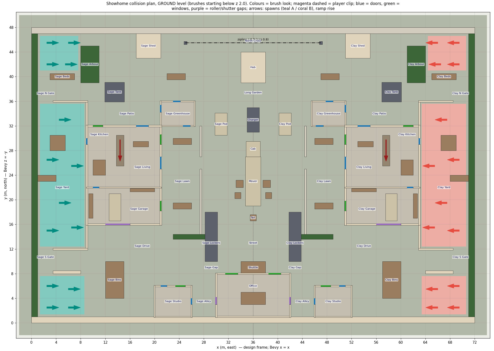
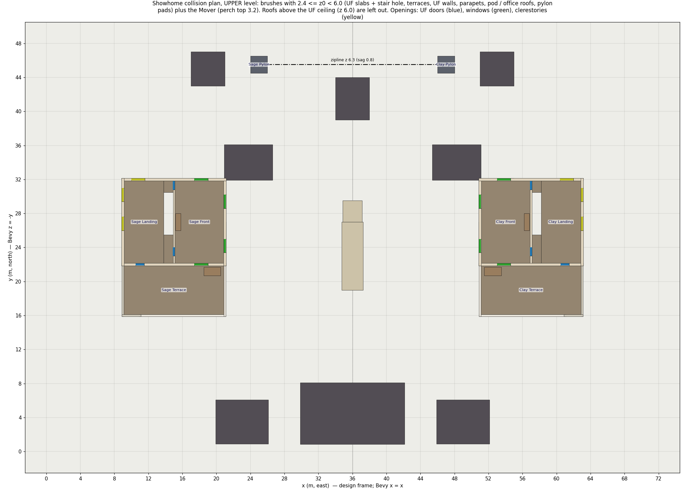
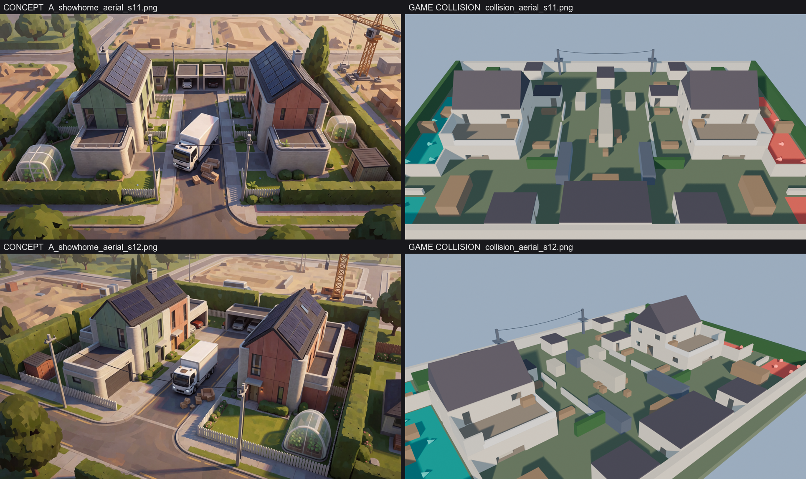

# Showhome: the gameplay layout the art must sit on

This folder is the **ground truth for the Showhome art kit**. Everything in it comes from the brush list the
game actually collides with, `vetf_sim::maps::showhome()` (`game/crates/vetf_sim/src/maps/showhome.rs`, which is
ported from `design/maps/tdm/src/showhome_layout.py`). The art must match these brushes **within 2 cm**: every
walkable surface, wall face, opening, stair, fence and cover piece. Decoration may add small detail. It must
not block a path or sightline that the collision leaves open, and it must not leave collision uncovered (no
invisible walls). Set dressing outside the playable rect (x 0..72, y 0..48) is free.

## Regenerate

```bash
export PATH="$USERPROFILE/.cargo/bin:$PATH"
cd "F:/git/val etf/assets/maps/showhome/layout"
python annotate_layout.py --dump        # cargo-builds tools/level_dump, re-dumps both levels, re-tags, re-plots,
                                        # refreshes the AUTO tables below; exits 1 if a brush cannot be named
"C:/Program Files/Blender Foundation/Blender 5.2/blender.exe" -b --factory-startup -P collision_preview.py
python compare_concept.py               # concept vs collision side-by-side sheets
```

If `showhome.rs` changes (another session owns `game/`), re-run the first command. `source_fnv1a64` in the JSON
fingerprints the sim files that the dump was built from.

| File | What it is |
|---|---|
| `showhome_level.json` | Raw dump of the game Level: every brush (kind, look, box, ramp + slope plane) in **both** frames, spawns, zipline, kill plane, bounds. Ground truth. |
| `range_level.json` | The same dump for the gun range ("The Yard", 244 brushes, 32 range targets), for later. |
| `showhome_annotated.json` | Every brush with a **tag** (`id`, `part`, `structure`), the structure table, all 52 openings (each checked clear in collision), spawns with design ids, and design-only markers (pickups, perches, callouts, sightlines). |
| `layout_lib.py` | Pure-Python reader for the above (works inside Blender): `load()`, `brushes(structure=, tag=, part=)`, `openings()`, `brush_polys()`, `to_bevy()`. Build the kit from this, not from hand-typed numbers. |
| `check_alignment.py` | **Run this on every art build.** Blender script: casts 134k rays into the collision and into the art, and reports GHOST (art where collision is open) and INVISIBLE (collision without art) mismatches beyond 2 cm. `--selftest` proves it catches a 10 cm shift, a missing wall piece and a ghost tree. `plot_alignment.py` plots a report. |
| `collision_preview.py` → `showhome_collision_preview.blend/.glb` | One coloured object per brush, in one collection per structure (`S_SAGE_HOUSE`, ...). Origins sit at brush centres; custom props hold `brush_index`, `tag_id`, `part`. Snap kit pieces to these. |
| `renders/plan_ground.png`, `plan_upper.png` | Labelled plans (callouts, openings, spawns, ramps, clips), 4 m grid. |
| `renders/section_A_y26.png`, `section_C_x36.png`, `section_D_x14.4.png` | Sections with real heights. |
| `renders/collision_*.png`, `compare_concept_*.png` | Blender renders of the collision (top, concept-matched aerials, eye-level), and concept vs collision sheets. |

## Coordinate frames (verified)

| Frame | Axes | Use |
|---|---|---|
| **Design / Blender** | metres, **x = east, y = north, z = up**, origin at the SW map corner | Build everything here. All tables below use it. |
| **Bevy (game)** | metres, Y up, north = **−Z** | `bevy = (x, z, −y)`, `design = (bevy.x, −bevy.z, bevy.y)` |

- The glTF exporter's **+Y up** conversion of a Z-up Blender scene is exactly this mapping. Spawn the exported
  `.glb` at `Transform::IDENTITY` in Bevy, with no offset, rotation or scale. Checked: in
  `showhome_collision_preview.glb` the Mover box node sits at Bevy `(36, 1.6, −23)`, which is the sim brush
  `(34.75, 0, −27)..(37.25, 3.2, −19)`.
- A design plan rect `(x0, y0, x1, y1)` over heights `z0..z1` is the Bevy box `(x0, z0, −y1)..(x1, z1, −y0)`.
- Yaw: in the design frame 0° faces east (+x) and 90° faces north. Sim yaw (radians) = `radians(design_deg − 90)`.
  Sage (team A, west) spawns face east, and Clay (team B, east) spawns face west.
- The map is **mirror-symmetric about x = 36**: `x → 72 − x` maps west (Sage, `W_*`) to east (Clay, `E_*`).
  `C_*` pieces sit on the axis. Build the west half and mirror it, but keep the team colourways: the brushes
  are symmetric while the art is not (Sage = sage green cladding, Clay = terracotta).

## What the brushes mean

`BrushKind` (in `movement/collision.rs`) sets what a brush blocks:

| Kind | Blocks | Art rule |
|---|---|---|
| `Solid` | players + bullets + sight | Must be **visibly solid and opaque** at exactly its faces. 325 of 334 brushes. |
| `PlayerClip` | players only (bullets pass) | Invisible: map-edge clips above the hedge/fence/wall up to z 10, a hard ceiling at z 10..11, and the steep invisible roof clip over each gable. **No art** (the roof sits under the roof clip). |
| `BulletOnly` | bullets + sight only | Unused on Showhome. Nothing is glass in collision. **Every window and door is an open hole.** |

A brush is an axis-aligned box. A **ramp** (`shape: "ramp"`) is a wedge in its box: the top rises from `z_low`
at one edge to `z_high` at the `rise_toward` edge. Showhome has 2 stairs (32.6°), 4 gable halves (45°) and
4 roof clips (50°).

`Look` is the game's placeholder colour (`val_etf/src/render.rs`). Here is what each look means for the art:

| Look | Showhome use | Art |
|---|---|---|
| `Ground` | ground slab, top at **z = 0** everywhere | asphalt, paving, lawn and soil, **all flush at z 0 (±2 cm)**, so no raised kerbs (see rules) |
| `TeamA` / `TeamB` | ground of the 3 spawn zones per side | paving with a teal / coral accent, so the spawns still read |
| `Floor` | building floors (ground slab), UF slab, terrace slab, stair ramp | interior floor, terrace decking, stair |
| `Wall` | house walls, pod walls, garden/yard walls, low wall, shed and hub bodies, south boundary wall | printed concrete or cladding (see the structures below) |
| `Trim` | terrace parapets (1.0 m) | solid printed-concrete parapet with coping. **Not a glass railing** |
| `Fence` | picket fences, privacy screens (2.4 m), north acoustic fence | solid boards. No see-through gaps (they block bullets) |
| `Roof` | gables, UF ceiling slab, pod/office roof slabs, shed/hub caps | dark roof tiles and solar panels, flat roof membranes |
| `Prop` | furniture, planters, beds, bins, BBQ wall, hot tub, crates, armchairs, model table, shuttle stop | the named prop, filling its box |
| `Hedge` | boundary hedges (3 m), lawn hedge (2 m), arbour (2.4 m) | dense clipped hedge, arbour as a vine-covered solid mass |
| `Vehicle` | Mover box + cab, kerb delivery pods, garage cars | boxy vehicles that fill their box, with skirts to the ground |
| `Metal` | tanks, pylon masts + pads, lockers, charger island | as named |

**Walls with openings.** A wall is centred on its line, `t` thick (0.3 for house exteriors, 0.2 for partitions
and pods, 0.25 for parapets, screens and the office). It runs `t/2` past both ends, so corners are closed solid
squares. Each opening cuts the wall into a **pier** (full height), a **sill** (wall bottom to the opening sill) and
a **lintel** (opening head to wall top). Tags show which: `W_GF_E` / `lintel` / opening `W_GF_FRONT`.

## Heights

| What | z (m) |
|---|---|
| Ground (top of the slab, which runs from z −1 and reaches 2 m past the map edge) | 0 |
| Ground-floor walls (house) | 0..3.2 |
| Upper-floor slab (UF floor and terrace = garage roof) | 2.95..**3.2** |
| Terrace parapet / privacy screen | 3.2..4.2 / 3.2..5.6 |
| UF walls / UF partition / UF ceiling slab | 3.2..6.2 / 3.2..6.0 / 6.0..6.2 |
| Gable (45°, ridge east-west at y 27), eaves → ridge | 6.2 → **11.2** |
| Greenhouse + studio: walls / flat roof slab (0.1 overhang) | 0..2.6 / 2.6..2.8 |
| Sales office: walls / flat roof (perch J_OFFICE) | 0..2.8 / 2.8..**3.0** |
| Shed / hub: body + roof cap (flat, closed) | 0..2.6 / 0..3.0 |
| Mover box top (perch J_MOVER) / cab | **3.2** / 2.4 |
| Pylon pads (perch J_PAD, 2×2 m grating) / mast top / zipline anchors | 3.85..**4.0** / 6.6 / 6.3 |
| Boundary: W/E hedge, N fence, S wall | 3.0, 2.4, 2.4 (player clip above, up to 10) |
| Hard ceiling (player clip) / kill plane | 10 / −10 |

## Map overview



- **Playable rect** x 0..72, y 0..48. The **west half is Sage (team A)** and the **east half is Clay (team B)**.
  The street runs north–south on the axis x = 36.
- Each side, from the boundary inward: the spawn yard (x 1..9, walled), the **house** (x 9..21; the garage
  + terrace is the south third, y 16..22; the 2-storey main block is y 22..32), the front lawn (x 21..27.5,
  closed by picket fences at x 27.5 with a gate gap at y 25..27), the sidewalk (lockers), then the **street**.
- North lane (y 36..47): the back garden, tank, arbour, shed, and the **pylon with the zipline** to the other pylon
  (x 25 ↔ 47, y 45.5, z 6.3). The hub kiosk stands in the turning circle on the axis.
- South lane (y 1..16): the drive, bins, the **studio** pod, and the **sales office** across the axis (x 30..42,
  y 1..8) with the shuttle stop in front of it.
- Centre: the **Mover** (driverless removal truck), parked north–south on the axis. Its **cab is at the north end**
  (y 27..29.5) and its box tail is at y 19. An armchair and a crate are spilled on each side of the box, and a
  tail crate stands at y 17. The charger island is north of the cab, and the parked delivery pods stand at the
  kerbs (x 29.8..31.8 and 40.2..42.2, y 30.5..34.1).



## Structures

<!-- AUTO:structures -->
| Structure | Side | Bounds (design, visible brushes) | Brushes | Openings |
|---|---|---|---|---|
| **SAGE_HOUSE**<br>Sage House (2 floors + garage, terrace on the garage roof, 45 deg gable) | W | x 8.85..21.15, y 15.85..32.15, z 0..11.2 | 71 | W_GF_ROLLER, W_GF_GARWIN, W_GF_FRONT, W_GF_LIVWIN, W_GF_PATIO, W_GF_KITWIN, W_GF_BACK, W_GF_GARDOOR, W_UF_TERDOOR, W_UF_WIN_S, W_UF_WIN_N, W_UF_WIN_NF, W_UF_WIN_T, W_UF_CLR_W1, W_UF_CLR_W2, W_UF_CLR_N, W_UF_PD1, W_UF_PD2 |
| **CLAY_HOUSE**<br>Clay House (2 floors + garage, terrace on the garage roof, 45 deg gable) | E | x 50.85..63.15, y 15.85..32.15, z 0..11.2 | 71 | E_GF_ROLLER, E_GF_GARWIN, E_GF_FRONT, E_GF_LIVWIN, E_GF_PATIO, E_GF_KITWIN, E_GF_BACK, E_GF_GARDOOR, E_UF_TERDOOR, E_UF_WIN_S, E_UF_WIN_N, E_UF_WIN_NF, E_UF_WIN_T, E_UF_CLR_W1, E_UF_CLR_W2, E_UF_CLR_N, E_UF_PD1, E_UF_PD2 |
| **SAGE_HOUSE_PROPS**<br>Sage House furniture and terrace heat pump | W | x 9.3..20.5, y 16.6..29.5, z 0..4.4 | 7 | - |
| **CLAY_HOUSE_PROPS**<br>Clay House furniture and terrace heat pump | E | x 51.5..62.7, y 16.6..29.5, z 0..4.4 | 7 | - |
| **SAGE_GREENHOUSE**<br>Sage Greenhouse (enterable, 3 doors, flat roof slab) | W | x 20.9..26.6, y 31.9..36.1, z 0..2.8 | 11 | W_GH_W, W_GH_N, W_GH_S |
| **CLAY_GREENHOUSE**<br>Clay Greenhouse (enterable, 3 doors, flat roof slab) | E | x 45.4..51.1, y 31.9..36.1, z 0..2.8 | 11 | E_GH_W, E_GH_N, E_GH_S |
| **SAGE_STUDIO**<br>Sage Studio (enterable garden office, 2 doors + window) | W | x 19.9..26.1, y 0.9..6.1, z 0..2.8 | 12 | W_ST_N, W_ST_E, W_ST_WIN |
| **CLAY_STUDIO**<br>Clay Studio (enterable garden office, 2 doors + window) | E | x 45.9..52.1, y 0.9..6.1, z 0..2.8 | 12 | E_ST_N, E_ST_E, E_ST_WIN |
| **SAGE_SHED**<br>Sage Shed (closed solid) | W | x 17..21, y 43..47, z 0..2.6 | 2 | - |
| **CLAY_SHED**<br>Clay Shed (closed solid) | E | x 51..55, y 43..47, z 0..2.6 | 2 | - |
| **SAGE_YARD**<br>Sage spawn yard walls + hot tub + outdoor kitchen | W | x 1..9.15, y 11.85..36.15, z 0..2.6 | 6 | - |
| **CLAY_YARD**<br>Clay spawn yard walls + hot tub + outdoor kitchen | E | x 62.85..71, y 11.85..36.15, z 0..2.6 | 6 | - |
| **SAGE_LAWN**<br>Sage front lawn: picket fences, lawn hedge, planters | W | x 23..28.2, y 13.6..32, z 0..2 | 5 | - |
| **CLAY_LAWN**<br>Clay front lawn: picket fences, lawn hedge, planters | E | x 43.8..49, y 13.6..32, z 0..2 | 5 | - |
| **SAGE_GARDEN**<br>Sage back garden: tank, arbour, veg beds | W | x 3..25, y 35.9..45, z 0..2.8 | 4 | - |
| **CLAY_GARDEN**<br>Clay back garden: tank, arbour, veg beds | E | x 47..69, y 35.9..45, z 0..2.8 | 4 | - |
| **SAGE_PYLON**<br>Sage Pylon (utility pole + service pad, zipline anchor) | W | x 24..26, y 44.5..46.5, z 0..6.6 | 2 | - |
| **CLAY_PYLON**<br>Clay Pylon (utility pole + service pad, zipline anchor) | E | x 46..48, y 44.5..46.5, z 0..6.6 | 2 | - |
| **SAGE_DRIVE**<br>Sage drive: low wall, bin store, parcel lockers | W | x 3.5..30.2, y 4..18, z 0..2.2 | 3 | - |
| **CLAY_DRIVE**<br>Clay drive: low wall, bin store, parcel lockers | E | x 41.8..68.5, y 4..18, z 0..2.2 | 3 | - |
| **SAGE_STREET**<br>Sage-side street props: kerb delivery pod, armchair, crate | W | x 29.8..34.4, y 20.2..34.1, z 0..2.2 | 3 | - |
| **CLAY_STREET**<br>Clay-side street props: kerb delivery pod, armchair, crate | E | x 37.6..42.2, y 20.2..34.1, z 0..2.2 | 3 | - |
| **SAGE_BOUNDARY**<br>West boundary hedge (+ player clip to the hard ceiling) | W | x 0..1, y 1..47, z 0..3 | 2 | - |
| **CLAY_BOUNDARY**<br>East boundary hedge (+ player clip to the hard ceiling) | E | x 71..72, y 1..47, z 0..3 | 2 | - |
| **MOVER_TRUCK**<br>Mover: driverless removal truck (box = perch 3.2, cab 2.4) | C | x 34.75..37.25, y 19..29.5, z 0..3.2 | 2 | - |
| **STREET_CENTRE**<br>Centre-line props: charger island, tail crate | C | x 35..37, y 16.6..35, z 0..2.4 | 2 | - |
| **SALES_OFFICE**<br>Sales office (shutters W+E, 2 street windows, model table, flat roof perch 3.0) | C | x 29.875..42.125, y 0.875..8.125, z 0..3 | 16 | W_OF_W, W_OF_WIN, E_OF_W, E_OF_WIN |
| **SHUTTLE_STOP**<br>Shuttle stop shelter against the office front | C | x 34..38, y 8..10, z 0..2.6 | 1 | - |
| **HUB**<br>Parcel hub kiosk in the turning circle (closed solid) | C | x 34..38, y 39..44, z 0..3 | 2 | - |
| **BOUNDARY_N**<br>North acoustic fence (+ player clip) | C | x 0..72, y 47..48, z 0..2.4 | 2 | - |
| **BOUNDARY_S**<br>South boundary wall (+ player clip) | C | x 0..72, y 0..1, z 0..2.4 | 2 | - |
| **MAP_CEILING**<br>Invisible hard ceiling at z 10 over the map | C | x 0..72, y 0..48, z 10..11 | 1 | - |
<!-- /AUTO:structures -->

### Walls (west side; east = mirror)

<!-- AUTO:walls -->
| Wall | Kind | Floor | Pieces (pier / sill / lintel) | z | Thickness |
|---|---|---|---|---|---|
| W_GF_S | ext | GF | 2 / 0 / 1 | 0..3.2 | 0.3 |
| W_GF_E | ext | GF | 4 / 2 / 3 | 0..3.2 | 0.3 |
| W_GF_N | ext | GF | 3 / 1 / 2 | 0..3.2 | 0.3 |
| W_GF_W | ext | GF | 2 / 0 / 1 | 0..3.2 | 0.3 |
| W_GF_P | int | GF | 2 / 0 / 1 | 0..3.2 | 0.2 |
| W_UF_S | ext | UF | 3 / 1 / 2 | 3.2..6.2 | 0.3 |
| W_UF_E | ext | UF | 3 / 2 / 2 | 3.2..6.2 | 0.3 |
| W_UF_N | ext | UF | 3 / 2 / 2 | 3.2..6.2 | 0.3 |
| W_UF_W | ext | UF | 3 / 2 / 2 | 3.2..6.2 | 0.3 |
| W_UF_P | int | UF | 3 / 0 / 2 | 3.2..6 | 0.2 |
| W_TER_PS | parapet | UF | 1 / 0 / 0 | 3.2..4.2 | 0.25 |
| W_TER_PE | parapet | UF | 1 / 0 / 0 | 3.2..4.2 | 0.25 |
| W_TER_SW | screen | UF | 1 / 0 / 0 | 3.2..5.6 | 0.25 |
| W_TER_SS | screen | UF | 1 / 0 / 0 | 3.2..5.6 | 0.25 |
| W_GH_WALL_S | pod | GF | 2 / 0 / 1 | 0..2.6 | 0.2 |
| W_GH_WALL_N | pod | GF | 2 / 0 / 1 | 0..2.6 | 0.2 |
| W_GH_WALL_W | pod | GF | 2 / 0 / 1 | 0..2.6 | 0.2 |
| W_GH_WALL_E | pod | GF | 1 / 0 / 0 | 0..2.6 | 0.2 |
| W_ST_WALL_S | pod | GF | 1 / 0 / 0 | 0..2.6 | 0.2 |
| W_ST_WALL_N | pod | GF | 3 / 1 / 2 | 0..2.6 | 0.2 |
| W_ST_WALL_W | pod | GF | 1 / 0 / 0 | 0..2.6 | 0.2 |
| W_ST_WALL_E | pod | GF | 2 / 0 / 1 | 0..2.6 | 0.2 |
| C_OF_WALL_S | pod | GF | 1 / 0 / 0 | 0..2.8 | 0.25 |
| C_OF_WALL_N | pod | GF | 3 / 2 / 2 | 0..2.8 | 0.25 |
| C_OF_WALL_W | pod | GF | 2 / 0 / 1 | 0..2.8 | 0.25 |
| C_OF_WALL_E | pod | GF | 2 / 0 / 1 | 0..2.8 | 0.25 |
<!-- /AUTO:walls -->

### Openings (west + centre; east = mirror, `E_` ids)

All 52 openings are verified open in the collision. A door is open from the floor to its head. A window has a
solid sill: GF windows have a 0.9 m sill, which you can vault. UF windows sit 1.0 m above the UF floor. UF
clerestories sit 1.8–2.4 m above the UF floor, which is above eye height, so there is no line of sight into
the spawn.
The garage **roller door** and the office **shutters** are jammed half-open: the gap is from z 0 to 1.1, and
players slide under it.

<!-- AUTO:openings -->
| Opening | Kind | Wall | Line | Span along wall | Sill..head (z) | Clear in collision | Note |
|---|---|---|---|---|---|---|---|
| W_GF_ROLLER | roller | W_GF_S | y = 16 | 12..16 | 0..1.1 | yes | roller door jammed half-open: 1.1 m gap, crouch or slide under |
| W_GF_GARWIN | window | W_GF_E | x = 21 | 18.2..19.8 | 0.9..2.1 | yes | vaultable |
| W_GF_FRONT | door2 | W_GF_E | x = 21 | 25..27 | 0..2.4 | yes | front door, double |
| W_GF_LIVWIN | window | W_GF_E | x = 21 | 29..30.6 | 0.9..2.1 | yes | vaultable |
| W_GF_PATIO | door2 | W_GF_N | y = 32 | 17..19 | 0..2.4 | yes | sliding patio door |
| W_GF_KITWIN | window | W_GF_N | y = 32 | 10..11.6 | 0.9..2.1 | yes | vaultable |
| W_GF_BACK | door | W_GF_W | x = 9 | 29..30 | 0..2.1 | yes | back door to spawn yard |
| W_GF_GARDOOR | door | W_GF_P | y = 22 | 10..11 | 0..2.1 | yes | garage <-> kitchen |
| W_UF_TERDOOR | door | W_UF_S | y = 22 | 10.5..11.5 | 3.2..5.3 | yes | landing -> terrace |
| W_UF_WIN_S | window | W_UF_E | x = 21 | 23.4..25 | 4.2..5.4 | yes | street window S |
| W_UF_WIN_N | window | W_UF_E | x = 21 | 28.6..30.2 | 4.2..5.4 | yes | street window N |
| W_UF_WIN_NF | window | W_UF_N | y = 32 | 17.4..19 | 4.2..5.4 | yes | garden window |
| W_UF_WIN_T | window | W_UF_S | y = 22 | 17.4..19 | 4.2..5.4 | yes | onto terrace, vaultable |
| W_UF_CLR_W1 | clerestory | W_UF_W | x = 9 | 26..27.6 | 5..5.6 | yes | sill above eye height: no LOS into spawn |
| W_UF_CLR_W2 | clerestory | W_UF_W | x = 9 | 29.4..31 | 5..5.6 | yes |  |
| W_UF_CLR_N | clerestory | W_UF_N | y = 32 | 10..11.6 | 5..5.6 | yes |  |
| W_UF_PD1 | door | W_UF_P | x = 15 | 23..24 | 3.2..5.3 | yes | landing -> front room |
| W_UF_PD2 | door | W_UF_P | x = 15 | 30.8..31.8 | 3.2..5.3 | yes | landing -> front room |
| W_GH_W | door | W_GH_WALL_W | x = 21 | 34.2..35.4 | 0..2.1 | yes | greenhouse <-> patio |
| W_GH_N | door | W_GH_WALL_N | y = 36 | 23..24.2 | 0..2.1 | yes | greenhouse <-> garden |
| W_GH_S | door | W_GH_WALL_S | y = 32 | 24.6..25.8 | 0..2.1 | yes | greenhouse <-> lawn |
| W_ST_N | door | W_ST_WALL_N | y = 6 | 21..22 | 0..2.1 | yes | studio door |
| W_ST_E | door | W_ST_WALL_E | x = 26 | 3..4 | 0..2.1 | yes | studio door to alley |
| W_ST_WIN | window | W_ST_WALL_N | y = 6 | 23.4..25 | 0.9..2.1 | yes | studio window |
| W_OF_W | shutter | C_OF_WALL_W | x = 30 | 3..4.2 | 0..1.1 | yes | office shutter half-open: slide gap 1.1 m |
| W_OF_WIN | window | C_OF_WALL_N | y = 8 | 31.5..33.5 | 0.9..2.1 | yes | office street window |
<!-- /AUTO:openings -->

### Solid elements (one brush each; west + centre)

<!-- AUTO:elements -->
| Id | Name | Kind (layout) | Look (game) | Box (design) | Kit hint |
|---|---|---|---|---|---|
| W_HEDGE | Boundary hedge | boundary | Hedge | x 0..1, y 1..47, z 0..3 | HEDGE_BOUNDARY_4m |
| W_YARD_N | Yard wall N | garden_wall | Wall | x 3.5..9.15, y 35.85..36.15, z 0..2.6 | GARDEN_WALL_2m |
| W_YARD_S | Yard wall S | garden_wall | Wall | x 3.5..9.15, y 11.85..12.15, z 0..2.6 | GARDEN_WALL_2m |
| W_YARD_EN | Yard wall NE stub | garden_wall | Wall | x 8.85..9.15, y 32..35.85, z 0..2.6 | GARDEN_WALL_2m |
| W_YARD_ES | Yard wall SE stub | garden_wall | Wall | x 8.85..9.15, y 12.15..16, z 0..2.6 | GARDEN_WALL_2m |
| W_HOTTUB | Hot-tub pod | prop_low | Prop | x 3..5.5, y 28..30.5, z 0..1 | HOTTUB_2.5 |
| W_BBQ | Outdoor-kitchen wall | prop_full | Prop | x 1..4, y 23..24, z 0..2.2 | BOX_3x1x2.2 |
| W_HEATPUMP | Heat pump | prop_low | Prop | x 18.5..20.5, y 20.7..21.7, z 3.2..4.4 | BOX_2x1x1.2 |
| W_ISLAND | Kitchen island | prop_low | Prop | x 10..12, y 24..26.5, z 0..1 | COUNTER_2x2.5 |
| W_GARAGE_CAR | Garage e-car | prop_low | Vehicle | x 12.6..14.5, y 16.6..21, z 0..1.5 | CAR_COMPACT |
| W_WORKBENCH | Workbench | prop_low | Prop | x 9.3..10, y 17..21, z 0..1 | BOX_0.7x4x1 |
| W_SHELF | Shelving | prop_full | Prop | x 16..20, y 21.3..21.85, z 0..2.2 | SHELF_4m |
| W_SOFA | Sofa | prop_low | Prop | x 16.5..19, y 28.6..29.5, z 0..0.8 | SOFA_2.5 |
| W_DRESSER | Dresser | prop_low | Prop | x 15.2..15.8, y 26..28, z 3.2..4.4 | BOX_0.6x2x1.2 |
| W_FENCE_FS | Picket fence | fence | Fence | x 27.35..27.65, y 14.4..25, z 0..1.2 | FENCE_1.2_2m |
| W_FENCE_FN | Picket fence | fence | Fence | x 27.35..27.65, y 27..32, z 0..1.2 | FENCE_1.2_2m |
| W_HEDGE_LAWN | Lawn hedge | prop_full | Hedge | x 23..28.2, y 13.6..14.4, z 0..2 | HEDGE_2m |
| W_PLANTER_1 | Lawn planter | prop_low | Prop | x 23..26, y 18.5..19.5, z 0..1 | PLANTER_3x1 |
| W_PLANTER_2 | Lawn planter | prop_low | Prop | x 23..26, y 29..30, z 0..1 | PLANTER_3x1 |
| W_TANK | Sage Tank | prop_full | Metal | x 11.9..15.1, y 35.9..39.1, z 0..2.8 | TANK_D3.2 |
| W_BEDS_1 | Veg beds | prop_low | Prop | x 3..7, y 39.5..40.5, z 0..1 | PLANTER_4x1 |
| W_ARBOUR | Sage Arbour | prop_full | Hedge | x 8..11, y 39..45, z 0..2.4 | ARBOUR_3x6 |
| W_BEDS_3 | Veg beds | prop_low | Prop | x 22..25, y 39.5..40.5, z 0..1 | PLANTER_3x1 |
| W_PYLON_MAST | Pylon mast | mast | Metal | x 24.75..25.25, y 45.25..45.75, z 0..6.6 | PYLON |
| W_PYLON_PAD | Sage Pylon pad | perch | Metal | x 24..26, y 44.5..46.5, z 3.85..4 | PYLON |
| W_LOWWALL | Low wall | prop_low | Wall | x 3.5..8, y 8..8.5, z 0..1 | LOW_WALL_1m |
| W_BINS | Sage Bins | prop_full | Prop | x 12..15, y 4..10, z 0..2.2 | BIN_STORE_3x6 |
| W_LOCKERS | Sage Lockers | prop_full | Metal | x 28.2..30.2, y 10..18, z 0..2.2 | PARCEL_LOCKER_2x2 |
| W_KERBPOD | Sage Pod | vehicle | Vehicle | x 29.8..31.8, y 30.5..34.1, z 0..2.2 | DELIVERY_POD |
| W_ARMCHAIR | Armchair | prop_low | Prop | x 33.2..34.4, y 22..23.2, z 0..0.8 | ARMCHAIR |
| W_CRATE | Crate | prop_low | Prop | x 33..34, y 20.2..21.2, z 0..1 | CRATE_1m |
| W_TERRACE | Sage Terrace | terrace | Floor | x 9..21, y 16..22, z 2.95..3.2 | FLOOR_4x4 |
| W_STAIR | Stairs | stair | Floor | x 13.8..15, y 25.5..30.5, z 0..3.2 | STAIR_1.2x5 |
| C_NWALL | North acoustic fence | boundary | Fence | x 0..72, y 47..48, z 0..2.4 | BOUNDARY_FENCE_4m |
| C_SWALL | South boundary wall | boundary | Wall | x 0..72, y 0..1, z 0..2.4 | BOUNDARY_FENCE_4m |
| C_MOVER_BOX | Mover | vehicle | Vehicle | x 34.75..37.25, y 19..27, z 0..3.2 | MOVER_TRUCK |
| C_MOVER_CAB | Cab | vehicle | Vehicle | x 34.85..37.15, y 27..29.5, z 0..2.4 | MOVER_TRUCK |
| C_CHARGER | Charger | prop_full | Metal | x 35..37, y 31..35, z 0..2.4 | CHARGER_ISLAND_2x3 |
| C_CRATE_T | Crate | prop_low | Prop | x 35.5..36.5, y 16.6..17.6, z 0..1 | CRATE_1m |
| C_MODEL | Model table | prop_low | Prop | x 34..38, y 3..5, z 0..1 | TABLE_4x2 |
| C_SHUTTLE | Shuttle | prop_full | Prop | x 34..38, y 8..10, z 0..2.6 | SHUTTLE_STOP_4x2 |
<!-- /AUTO:elements -->

## Spawns, zipline, markers

- 28 spawns (14 per team) stand at z 0 in 3 zones per side: **yard** (6), **garden** (4) and **drive** (4). Sage
  spawns face east and Clay spawns face west.
- Zipline "Postline": `(25, 45.5, 6.3)` ↔ `(47, 45.5, 6.3)`, 22 m long. The sim rides the straight line
  between the anchors. The design wants a **0.8 m sag**, which `showhome.rs` leaves to the renderer. The game
  draws a straight cylinder today. Draw it in the art as a sagging utility cable between the two pylon masts
  (0.8 m at mid-span; a thin cable counts as small detail).
- **Design-only markers.** The game Level does not have these yet. They are in `showhome_annotated.json →
  design_markers`: the pickups PK_C (Mover top), PK_S (office model table) and PK_N (turning circle, under the
  zipline), the perches (J_MOVER 3.2, J_OFFICE 3.0, J_PAD_W/E 4.0), callouts and named sightlines.

<!-- AUTO:spawns -->
| Id | Team | Design pos (x, y, z) | Yaw (design deg) | Bevy pos | Bevy yaw (rad) |
|---|---|---|---|---|---|
| W_YARD_1 | A | (2.5, 15.0, 0.0) | 0 | (2.5, 0.0, -15.0) | -1.5708 |
| W_YARD_2 | A | (6.5, 15.5, 0.0) | 0 | (6.5, 0.0, -15.5) | -1.5708 |
| W_YARD_3 | A | (4.5, 19.5, 0.0) | 0 | (4.5, 0.0, -19.5) | -1.5708 |
| W_YARD_4 | A | (2.5, 26.5, 0.0) | 0 | (2.5, 0.0, -26.5) | -1.5708 |
| W_YARD_5 | A | (6.5, 25.5, 0.0) | 0 | (6.5, 0.0, -25.5) | -1.5708 |
| W_YARD_6 | A | (4.5, 33.0, 0.0) | 0 | (4.5, 0.0, -33.0) | -1.5708 |
| W_GARDEN_1 | A | (2.5, 42.0, 0.0) | 0 | (2.5, 0.0, -42.0) | -1.5708 |
| W_GARDEN_2 | A | (5.5, 42.0, 0.0) | 0 | (5.5, 0.0, -42.0) | -1.5708 |
| W_GARDEN_3 | A | (2.5, 45.5, 0.0) | 0 | (2.5, 0.0, -45.5) | -1.5708 |
| W_GARDEN_4 | A | (6.0, 45.5, 0.0) | 0 | (6.0, 0.0, -45.5) | -1.5708 |
| W_DRIVE_1 | A | (2.5, 2.5, 0.0) | 0 | (2.5, 0.0, -2.5) | -1.5708 |
| W_DRIVE_2 | A | (6.0, 2.5, 0.0) | 0 | (6.0, 0.0, -2.5) | -1.5708 |
| W_DRIVE_3 | A | (2.5, 6.0, 0.0) | 0 | (2.5, 0.0, -6.0) | -1.5708 |
| W_DRIVE_4 | A | (6.0, 5.5, 0.0) | 0 | (6.0, 0.0, -5.5) | -1.5708 |
| E_YARD_1 | B | (69.5, 15.0, 0.0) | 180 | (69.5, 0.0, -15.0) | 1.5708 |
| E_YARD_2 | B | (65.5, 15.5, 0.0) | 180 | (65.5, 0.0, -15.5) | 1.5708 |
| E_YARD_3 | B | (67.5, 19.5, 0.0) | 180 | (67.5, 0.0, -19.5) | 1.5708 |
| E_YARD_4 | B | (69.5, 26.5, 0.0) | 180 | (69.5, 0.0, -26.5) | 1.5708 |
| E_YARD_5 | B | (65.5, 25.5, 0.0) | 180 | (65.5, 0.0, -25.5) | 1.5708 |
| E_YARD_6 | B | (67.5, 33.0, 0.0) | 180 | (67.5, 0.0, -33.0) | 1.5708 |
| E_GARDEN_1 | B | (69.5, 42.0, 0.0) | 180 | (69.5, 0.0, -42.0) | 1.5708 |
| E_GARDEN_2 | B | (66.5, 42.0, 0.0) | 180 | (66.5, 0.0, -42.0) | 1.5708 |
| E_GARDEN_3 | B | (69.5, 45.5, 0.0) | 180 | (69.5, 0.0, -45.5) | 1.5708 |
| E_GARDEN_4 | B | (66.0, 45.5, 0.0) | 180 | (66.0, 0.0, -45.5) | 1.5708 |
| E_DRIVE_1 | B | (69.5, 2.5, 0.0) | 180 | (69.5, 0.0, -2.5) | 1.5708 |
| E_DRIVE_2 | B | (66.0, 2.5, 0.0) | 180 | (66.0, 0.0, -2.5) | 1.5708 |
| E_DRIVE_3 | B | (69.5, 6.0, 0.0) | 180 | (69.5, 0.0, -6.0) | 1.5708 |
| E_DRIVE_4 | B | (66.0, 5.5, 0.0) | 180 | (66.0, 0.0, -5.5) | 1.5708 |
<!-- /AUTO:spawns -->

## Brush counts

<!-- AUTO:counts -->
| Kind / look | Count |
|---|---|
| Solid/Ground | 36 |
| Solid/TeamA | 3 |
| Solid/Floor | 18 |
| Solid/Hedge | 6 |
| Solid/Wall | 182 |
| Solid/Prop | 33 |
| Solid/Vehicle | 6 |
| Solid/Fence | 9 |
| Solid/Metal | 9 |
| PlayerClip/Invisible | 5 |
| Solid/Trim | 4 |
| Solid/Floor/ramp | 2 |
| Solid/Roof | 10 |
| Solid/Roof/ramp | 4 |
| PlayerClip/Invisible/ramp | 4 |
| Solid/TeamB | 3 |
| **total** | **334** |

Source fingerprint (FNV-1a 64 of the sim files the dump was built from): `maps/showhome.rs` 2fdcf09aa4c326a6, `maps/range.rs` 72664c2949234c7f, `maps/mod.rs` 744b0035f23b12ff, `movement/collision.rs` 5356737b0098de72, `level.rs` d833e7565467a34d.
<!-- /AUTO:counts -->

## Concept art vs collision: what the art has to resolve



These match the concept: two mirrored show homes with the garage and roof terrace on the **south** side; from
a south camera, Sage (green) is on the left and Clay (terracotta) on the right; a removal truck in the middle of
the street with spilled crates and armchairs; picket-fenced front lawns; hedged boundaries; greenhouses and
sheds; two utility pylons with a cable. These differ, and **the collision wins** each time:

1. **Gable orientation.** The ridge runs **east–west** (y 27). The gable *ends* face the street (east for Sage)
   and the yard, and the long roof slopes face north and south. The concept shows the gable ends to the camera
   at the street end. Put the cladding panels and the big UF street windows (W_UF_WIN_S/N) on the street-facing
   gable end. Put the solar panels on the N and S slopes, **flush (≤ 2 cm proud)**. The gable brush spans
   x 9..21 exactly. Keep the verge/eave trim within the wall face (x 8.85..21.15, y 21.85..32.15), which the roof
   clip covers.
2. **Wide street.** It is 29.7 m between the house fronts, against about 12 m in the concept. Suggested surface
   zoning (paint only, no collision): lawn x 21.15..27.35; sidewalk x 27.65..30.2 (lockers on it); road
   x 30.2..41.8 from the office front (y 10) to a turning circle around the hub (y ~37..47). Mirror for the east.
   The front-door path crosses the lawn through the fence gate gap at y 25..27.
3. **Truck orientation.** The cab faces **north** (y 27..29.5, 2.4 m tall, boxy cab-over). The box is y 19..27,
   3.2 m tall, and its top is a standable perch. The collision is solid to the ground ("side skirts closed"), so
   draw skirts down to z 0. The rear doors face south and must stay inside the box (closed, or a roll-up
   door). Open swing doors would be ghosts.
4. **Greenhouse.** It sits NE of each house (x 21..26.5, y 32..36), not at the front corner. Its roof is a
   **flat standable slab at 2.6..2.8**, and its walls block bullets. A tall dome would hang above the collision,
   and a jetpacker standing on the slab would be inside the glass. Make it a flat-topped glass pavilion with
   rounded shoulders inside z ≤ 2.8. Make the glazing **frosted / opaque** with plant silhouettes; it must not
   look see-through. It has 3 doors (W, N, S).
5. **Shed and hub are flat-topped closed boxes** (2.6 / 3.0). The design's pitched shed roof and the hub's
   dome to 3.6 are not in the collision. Studio and office roofs are flat slabs too.
6. **Terrace edge.** The parapet is a solid 1.0 m wall (`Trim`), and the W/SW privacy screens are solid
   2.4 m walls. The concept's glass railing would let you see through cover the game treats as opaque. Use a
   printed-concrete parapet and a slatted screen with no gaps. A glass top rail *above* 4.2 would be a ghost.
7. **Curved printed-concrete corners.** The wall corners are solid squares. A corner radius above about 5 cm
   leaves an invisible corner (2 cm at r = 5 cm, 12 cm at r = 30 cm). Express the 3D-printed look with
   horizontal ridges (±1–2 cm relief) and soft ≤ 5 cm bevels. Big curves need a collision change in
   `game/`, so ask for it rather than faking it.
8. **Circles are squares in collision.** Tank `W_TANK` is 3.2 × 3.2 × 2.8. Pylon mast is 0.5 × 0.5 × 6.6.
   Draw a square rain tank and a square-section concrete pole with ≤ 5 cm bevels, or ask the game side for
   octagonal brushes.
9. **Picket fences** are solid 0.3 m-thick, 1.2 m slabs: tight pickets on a solid backing board. The
   north acoustic fence is solid too.
10. **No trees, poles or bushes inside the playable rect** unless they sit inside a collision element (hedges,
    arbour, planters and beds; shrub tops ≤ the planter top + 2 cm). Put the concept's cypresses and round
    trees, extra utility poles, carports with cars, the crane, half-built plots, stacked materials and the
    suburban road **outside** x 0..72 / y 0..48. Canopies must not lean into the play volume. Players see over
    the 2.4–3 m boundaries from the UF, the perches and jetpack height (up to 10 m), so the backdrop has to be
    finished. Overhead cables are fine as thin detail.
11. **Ground is one flat plane at z 0.** Kerbs, sidewalks, lawn edges and road markings must be flush (≤ 2 cm).
    A real 15 cm kerb would float players or sink their feet, and would need ground brushes in `game/`.
12. **Interiors.** The stair is a **solid wedge** (closed underneath and on both sides, x 13.8..15.0, y 25.5..30.5,
    rising south; the design has 18 risers × 0.178 m). Tread nosings sit on the slope plane. Inner corners may sit
    below it by up to one step (`check_alignment` accepts art up to 0.30 m inside a stair ramp, but not above it). Furniture fills
    its boxes (island 1.0, sofa 0.8, dresser 1.2, shelf 2.2 solid-backed, workbench 1.0, garage car 1.5 boxy).
13. **Doors and windows are open holes.** Window frames go inside the wall thickness and intrude ≤ 2 cm into
    the opening. Door leaves stand open, flat against the wall. Draw the roller door and office shutters from
    z 1.1 up to the lintel. There is no glass anywhere (bullets fly through every opening).
14. **Chimneys** (concept) stick above the 45° roof with no collision. Leave them out, or ask the game side
    for a chimney brush.

## Next agents: workflow

1. Build the kit in Blender in the design frame from `layout_lib` (`L.brushes(structure="SAGE_HOUSE")`, ...),
   one structure at a time. Snap faces to the brush planes and offset only decorative relief (≤ 2 cm).
2. Export a `.glb` (+Y up) and run
   `blender -b --factory-startup -P check_alignment.py -- --art <your.glb>`. Then run `python plot_alignment.py`.
   Get GHOST and INVISIBLE to ≈ 0 outside of deliberate small detail.
3. Anything that cannot match (domes, big curves, chimneys, round tanks, raised kerbs) is a **collision change
   request** for the `game/` owner. Do not hide it in the art.
