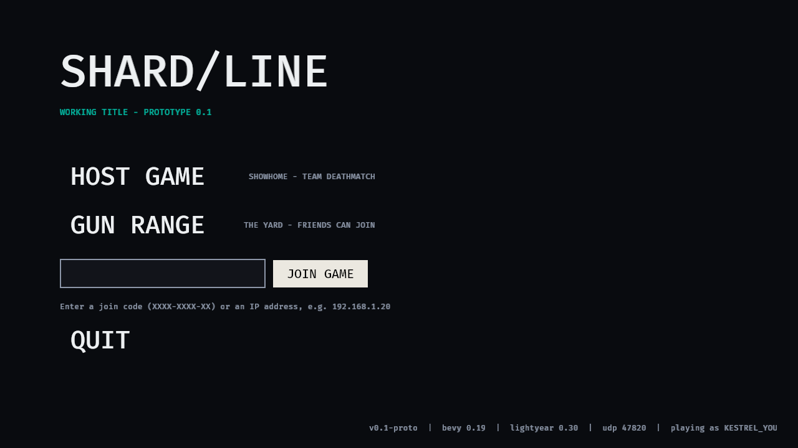

# SHARD/LINE: game code (`game/`)

Rust + Bevy 0.19 + lightyear 0.30, as chosen in `design/systems` (network diagram). It is a host-and-join
listen server: whoever hosts runs the server and plays in the same process, and friends join over UDP.



## Build and run

```sh
cd game
cargo run --release -p val_etf          # main menu
cargo test --workspace                  # gameplay math, design-data sync, netcode serialization
```

Linux needs the usual Bevy packages: `libasound2-dev libudev-dev libxkbcommon-dev libwayland-dev`.

### Hosting and joining
- **Host Game** (Showhome team deathmatch) or **Gun Range** from the menu hosts on **UDP 47820**.
  Hold **Tab** (or press **Esc**) to see the **join code**, e.g. `6000-105E-PC`, which encodes your address and
  port.
- **Join Game:** paste the join code, or type an IP (`192.168.1.20`) or `ip:port`.
- How a friend reaches you, per the network design:
  - **LAN:** works as is.
  - **Internet:** forward UDP 47820 on your router to your PC. Automatic UPnP is not built yet.
  - **No port forwarding:** use a VPN mesh such as Tailscale, ZeroTier or Radmin. Share your VPN IP, or the
    join code shown while the VPN address is your route.

### Controls

| Key | Action |
|---|---|
| WASD, mouse | Move, look |
| Shift | Sprint |
| Alt | Walk (silent) |
| Space | Jump. Press again in the air for the jetpack (hold); hold while moving into a ledge to mantle |
| Ctrl / C | Crouch. While sprinting: slide |
| F | Grab zipline |
| LMB | Fire |
| RMB | Aim (ADS) |
| B | Fire mode |
| R | Tap: reload the next magazine in slot order. Hold: magazine radial; release over a slot (or press 1-6) to load it. Magazines keep their slots |
| H | Heal ring: click an item; a region item opens a second ring to pick the region. Right click steps back |
| T | Mag check. Gives an estimate only; there is no ammo counter anywhere (genre rule) |
| Tab | Scoreboard and join code |
| Esc | Pause: resume or leave |

### Command line (automation and testing)
`val_etf [--host showhome|range] [--join CODE|IP[:PORT]] [--name NAME] [--port PORT] [--width W --height H]
[--screenshot PATH --screenshot-after S] [--exit-after S] [--bot] [--yaw DEG]
[--weapon ID] [--ammo AMMO | --mags std,ap2,..] [--armor PRESET] [--attach A,B] [--demo-ui reload|heal|heal-region]`

- `--bot` drives the local player.
- `--yaw` makes the bot hold a heading and shoot, which is useful for testing hits over the network.
- `--mags` lists magazines in slot order (up to six); `--ammo` loads every default magazine with one ammo.
- `--demo-ui reload|heal|heal-region` opens a ring menu for screenshots (the heal ones also hurt the host's player).

For example, a local two-process test:

```sh
val_etf --host range --name HOST &
val_etf --join 127.0.0.1:47820 --name JOINER --bot --yaw 90
```

## Layout

| Crate | What |
|---|---|
| `crates/vetf_sim` | Engine-free gameplay: data loading, damage/halo/health pipeline, weapons (fire rate, reloads, mag checks, spread, bloom, recoil), the character controller and brush collision, hitboxes and lag compensation, and the Showhome and Range levels. No Bevy, so it is fast to test and runs identically on host and clients. |
| `crates/vetf_net` | The lightyear protocol: replicated components, `PlayerInput`, messages (`Hello`, `ShotClaim`, `HitConfirm`, `DamageTaken`, `KillFeed`, `ShotFx`), channels, and join codes. |
| `crates/val_etf` | The game binary: menu, hosting and joining, the host authority (`server.rs`), the local player (`client.rs`), the shared predicted simulation (`shared.rs`), blockout rendering and the HUD. |
| `assets/fonts` | Barlow and Barlow Condensed (SIL OFL, see `OFL.txt`), the mockups' fonts, compiled into the binary. |
| `assets/data/*.ron` | **Every gameplay number.** They are loaded at start-up, so you can tune without rebuilding; the build also has a copy compiled in. `cargo test` fails if they drift from `design/systems/data/*.json`, except for the deliberate changes in [DESIGN_DELTAS.md](DESIGN_DELTAS.md). |

### Netcode model
The design is a listen server ticking at 60 Hz.

- **Inputs:** clients send inputs every tick, each packet repeating the last 10.
- **Prediction:** each client predicts its own movement and weapon, rolls back on mismatch, and interpolates
  other players about 100 ms behind.
- **Shots:**
  - The shooter's client raycasts against what it sees and sends a `ShotClaim`: shot number, ray, the tick it was
    viewing, zone and point.
  - The host has simulated the same shot from the same inputs. Ammo, fire rate and spread seed are
    host-authoritative.
  - The host checks the claim: muzzle position, aim cone, rewinding the victim by at most 200 ms, an inflated
    zone hitbox, and line of sight through the level. Then it applies halo and zone damage.
- **Replication:** the host sends snapshots at 30 Hz.

## Status: what works, what's next

**Works (tested):**
- Host and join over UDP, verified with two processes.
- Prediction and interpolation.
- Shot claims with lag compensation; hits, kills, kill feed and respawn.
- TDM score, timer and match end.
- Per-arc halo shields and per-zone HP with spill.
- Three guns: AR-7 Mako, VK-50 Warden and the SK-9 Skink SMG (the only gun that loads RIP).
- Ammo class × type × tier, picked per magazine (up to six ordered magazines).
- Rulesets: team deathmatch has no bleeding or broken-limb penalties; the range runs the full rules.
- Healing items with a heal ring: whole-body items (the only kind in team deathmatch) and region items.
- The full movement set: sprint, slide, jump, jetpack with design max-rise values, mantle, zipline, step-up and
  ramps.
- Recoil pattern and recovery; ADS behaviour.
- Mag check estimates.
- Both maps as blockouts.

**Not done yet:**
- Lobby, loadout and settings screens. Everyone spawns with the default loadout from `rules.ron`, although
  `Hello` already carries a loadout choice.
- UPnP and the LAN beacon.
- Range targets and aim-lab modes. `maps::range_targets()` exists, but nothing spawns from it yet.
- Character abilities (Kestrel scan, Solace heal) and energy drain.
- Warden sway and hold-breath, the bipod, aim punch, and Bulwark flinch reduction.
- Network visibility: exact enemy halo values only after a scan. Today all vitals replicate to everyone.
- Real art: glTF characters, weapons and halos. Everything is blockout boxes for now.
- Security: netcode uses a fixed private key, so this is a prototype for friends only.

**Known limits:**
- Leg spraying is only faster than shooting the torso with RIP in the SMG, against bare legs (by design).
- Some "not standable" roofs are flat in the blockout.
- On a CPU software renderer running two copies of the game (this cloud container), the frame rate gets so low
  that lightyear can drop inputs (more than 64 ticks out). It is fine on real GPUs.
